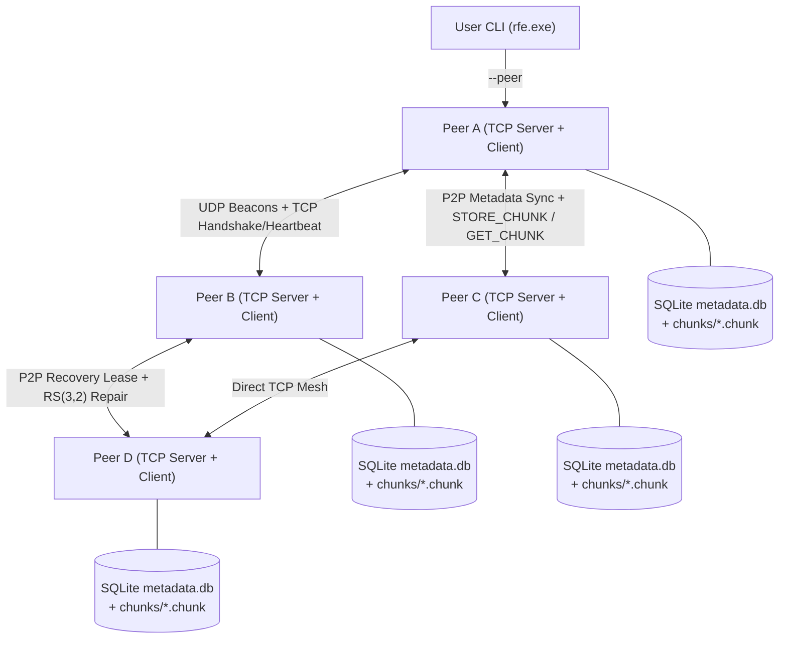

# Decentralized System Architecture (`ARCHITECTURE.md`)

**Project:** Peer-to-Peer Decentralized File Transfer and Recovery Engine  
**Architecture Model:** Symmetric Peer-to-Peer Mesh with Embedded Per-Peer SQLite Persistence and `RS(3,2)` Erasure Coding

---

## 1. Architectural Overview

Every node (`peer.exe`) in the network is structurally identical and runs four concurrent subsystems inside a single OS process:

1. **Framed TCP Server (`TCPServer`):** Accepts incoming peer handshakes, heartbeats, metadata synchronization messages, binary shard writes (`STORE_CHUNK`), binary shard reads (`GET_CHUNK`), recovery lease requests (`P2P_RECOVERY_LEASE_REQ`), and user CLI requests (`P2P_UPLOAD_FILE`, `P2P_CATALOGUE_QUERY`, `P2P_DOWNLOAD_FILE`).
2. **UDP Discovery Service (`UDPBeacon`):** Periodically broadcasts JSON discovery beacons (`P2P_BEACON`) to limited broadcast (`255.255.255.255:<discovery_port>`), directed `/24` subnet broadcast (`<subnet>.255:<discovery_port>`), loopback neighborhood ports, and configured unicast seed endpoints.
3. **Decentralized Peer Manager (`DecentralizedPeerManager`):** Executes outbound TCP handshakes (`P2P_HANDSHAKE`), periodic `250 ms` TCP heartbeats (`P2P_HEARTBEAT`), health state transitions (`ONLINE` $\rightarrow$ `SUSPECT` $\rightarrow$ `OFFLINE`), anti-entropy metadata synchronization (`P2P_METADATA_SUMMARY` / `P2P_METADATA_REQUEST`), and autonomous background durability repair (`run_autonomous_recovery_scan`).
4. **Embedded Persistence & Erasure Coding Engine (`DatabaseManager`, `AdaptiveChunker`, `ReedSolomon`, `DynamicDistributor`, `ClientDownload`):** Manages local SQLite state (`storage/peer_<ID>/metadata.db`) and binary `.chunk` files (`storage/peer_<ID>/chunks/<shard_id>.chunk`).

---

## 2. End-to-End Lifecycle Workflows

### 2.1 Peer Joining & Discovery
1. When `peer.exe` starts, it opens `storage/peer_<ID>/metadata.db`, cleans up any stale `.tmp` files from interrupted prior runs, and loads previously known peers from the `peers` table into its `PeerRegistry` and `UDPBeacon` seed list.
2. `UDPBeacon` broadcasts `P2P_BEACON` packets every `300 ms`.
3. When Peer X receives a beacon from an unknown or previously `OFFLINE` Peer Y, Peer X initiates a direct TCP connection to `Y.address:Y.port` and sends `P2P_HANDSHAKE`.
4. Peer Y records Peer X as `ONLINE` in its `PeerRegistry` and SQLite `peers` table, and responds with `P2P_HANDSHAKE_ACK` containing Y's workload and Y's known peer list (`peers` gossip).
5. Both peers immediately run anti-entropy metadata synchronization (`sync_metadata_with_peer`) so any manifests or recovery records created while a peer was offline are reconciled within milliseconds.

### 2.2 File Upload, Adaptive Chunking & `RS(3,2)` Distribution
1. The user runs `rfe upload <file> --peer <entry_ip:port>` targeting **any** online peer.
2. `rfe` computes the original file size and full-file SHA-256 digest and streams the request (`P2P_UPLOAD_FILE`) to the entry peer.
3. The entry peer verifies the full-file SHA-256 and invokes `DynamicDistributor::upload_and_distribute_p2p()`:
   - **Adaptive Chunking (`AdaptiveChunker`):** Selects shard size based on file size (`64 KB` for $< 10\text{ MB}$, `256 KB` for $10\text{–}100\text{ MB}$, `1 MB` for $> 100\text{ MB}$). Each stripe holds $2 \times \text{shard\_size}$ of file data.
   - **Systematic `RS(3,2)` Encoding (`ReedSolomon(2, 1)`):** Each stripe is split into 2 data shards (`D0`, `D1`, zero-padded on the final stripe with exact unpadded byte length recorded in `original_bytes`) and encoded over $\text{GF}(2^8)$ (`0x11D` polynomial) to produce 1 parity shard (`P0`). Each shard's SHA-256 is computed.
   - **Phase 1 SQLite Commit (`UPLOADING`, `version = 1`):** The manifest is persisted locally with `status = 'UPLOADING'`.
   - **Dynamic 3-Distinct-Peer Placement:** For each stripe, eligible `ONLINE` peers with sufficient free storage and available transfer slots are ranked by lowest shard count assigned so far, lowest active transfers, and highest free storage. The 3 shards (`D0`, `D1`, `P0`) are pushed via `STORE_CHUNK` to **3 distinct peers**.
   - **Atomic Destination Storage:** Each receiving peer verifies payload size, free disk space, and SHA-256, writes to `<shard_id>.chunk.<seq>.tmp`, atomically renames to `<shard_id>.chunk`, records the shard in its local SQLite database (`record_received_shard`), and returns `STORE_ACK`.
   - **Phase 2 SQLite Commit (`AVAILABLE`, `version = 2`) & Push Sync:** Once all stripes are stored, the entry peer updates the manifest to `status = 'AVAILABLE'`, `version = 2` and broadcasts `P2P_METADATA_PUSH` to all online peers.

### 2.3 Metadata Synchronization & Conflict Resolution
- **Immediate Push (`P2P_METADATA_PUSH`):** Broadcasts new or updated manifests (`version` incremented) and `recovery_records` immediately upon upload completion or shard repair.
- **Periodic Anti-Entropy (`P2P_METADATA_SUMMARY` / `P2P_METADATA_REQUEST`):** Every 2 heartbeat cycles (~500 ms) and upon peer handshake/rejoin, peers exchange `{file_id: version}` summaries and pull/push any missing or higher-version manifests.
- **Monotonic Version Protection:** `DatabaseManager::upsert_file_manifest()` runs in an atomic `BEGIN IMMEDIATE` transaction. Incoming manifests with `version < existing_version` are ignored. At equal or higher versions, `shard_locations` updates monotonically per `(shard_id, peer_id)`, with `STALE` / `CORRUPTED` taking precedence over `STORED` at equal version.

### 2.4 File Catalogue Search, Download & Reconstruction
1. **Search (`rfe search <query> --peer <ip:port>`):** Sends `P2P_CATALOGUE_QUERY` (`sync_if_missing = true`). The contacted peer reconciles any missing metadata from online peers and evaluates live reconstructability (`AVAILABLE` if $3/3$ shards/stripe online, `DEGRADED` if $2/3$ online, `UNRECOVERABLE` if $< 2/3$ online).
2. **Download (`rfe download <file_id|name> --peer <ip:port> --output <dest>`):**
   - `ClientDownload::download_p2p()` fetches the `FileManifest` and peer endpoint table from the contacted peer.
   - For each stripe (`S000`, `S001`, ...), it connects directly to the storage peers holding `D0`, `D1`, `P0` via `GET_CHUNK`, verifying each shard's byte length and SHA-256 against the manifest.
   - If a peer is `OFFLINE` or returns a corrupted shard (`SHA-256` mismatch), the downloader automatically fails over to the remaining shard in the stripe (e.g., `P0`) and reconstructs the missing data shard via `ReedSolomon(2, 1)::decode()`.
   - Once all stripes are reconstructed into `<output>.<seq>.tmp` and final-stripe zero-padding is stripped using `original_bytes`, the full-file SHA-256 is verified against `manifest.sha256` before atomically renaming `.tmp` to `<output>`.

### 2.5 Failure Detection & Autonomous Durability Recovery
1. **Heartbeat State Machine:** Every `250 ms`, each peer probes remote peers with `P2P_HEARTBEAT`. After `600 ms` without response, a peer transitions `ONLINE` $\rightarrow$ `SUSPECT`. After consecutive missed heartbeats reaching the failure threshold, it transitions `SUSPECT` $\rightarrow$ `OFFLINE`.
2. **Autonomous Repair Trigger:** Recovery **never** triggers on `SUSPECT`; it triggers only when a peer reaches `OFFLINE`.
3. **Deterministic Ownership & Distributed Lease (`P2P_RECOVERY_LEASE_REQ`):**
   - Each missing shard is identified by `REC:<file_id>:S<stripe>:<shard_id>`.
   - Online peer IDs (including `self_id`) are sorted lexicographically, and the primary owner is selected via `DJB2(recovery_id) % online_peer_ids.size()`.
   - The owner requests a `2500 ms` lease (`P2P_RECOVERY_LEASE_REQ`) from online peers and records `STARTED` in `recovery_records`. If the primary owner fails mid-recovery, its lease expires (or its health becomes `OFFLINE`), allowing a surviving backup peer to take over seamlessly.
4. **Reconstruction & 4th-Peer Placement:**
   - The owner fetches the 2 surviving shards of the stripe over TCP (`GET_CHUNK`), verifies their SHA-256, reconstructs the missing shard via `ReedSolomon(2, 1)::decode()`, and verifies the rebuilt shard's SHA-256.
   - It selects an `ONLINE` replacement peer with sufficient free storage that does **not** already hold any shard of that stripe, stores the rebuilt shard via `STORE_CHUNK`, marks the failed peer's location `STALE`, adds the replacement peer's location as `STORED`, increments `manifest.version`, records `COMPLETED` in `recovery_records`, and broadcasts the update to all peers.
5. **Failed Peer Rejoining (`reconcile_local_stale_shards`):**
   - When the failed peer restarts and rejoins, anti-entropy sync delivers the newer manifest version where its old shard location is marked `STALE`. The rejoined peer automatically deletes the obsolete `.chunk` file from its disk so no duplicate copies or stale metadata remain.

---

## 3. Per-Peer SQLite Schema (`storage/peer_<ID>/metadata.db`)

| Table | Primary Key | Purpose |
| :--- | :--- | :--- |
| `local_config` | `key` | Local node identity, bind address, TCP port, UDP discovery port, storage path, and quota. |
| `peers` | `peer_id` | Known peer endpoints, health state (`ONLINE`, `SUSPECT`, `OFFLINE`), storage & transfer load. |
| `files` | `file_id` | File manifest header (`original_name`, `file_size`, `sha256`, `shard_size`, `status`, `version`). |
| `stripes` | `(file_id, stripe_index)` | Per-stripe unpadded data byte count (`stripe_data_bytes`) and `shard_size`. |
| `shards` | `shard_id` | Per-shard metadata (`stripe_index`, `shard_index` `0..2`, `shard_type`, `original_bytes`, `sha256`). |
| `shard_locations` | `(shard_id, peer_id)` | Shard hosting peer map (`location_status`: `STORED`, `STALE`, `CORRUPTED`, `RECOVERING`, `version`). |
| `metadata_sync_log` | `update_id` | Idempotent operation log (`origin_peer_id`, `origin_seq`, `entity_type`, `entity_key`). |
| `recovery_records` | `recovery_id` | Distributed lease & audit log (`failed_peer_id`, `rebuilder_peer_id`, `target_peer_id`, `status`). |
